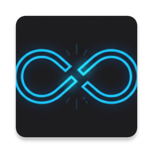
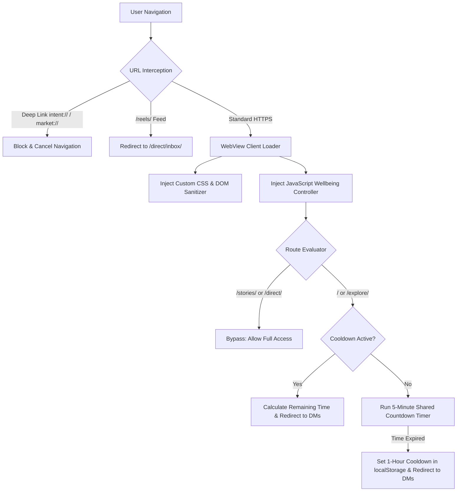

# NoReels — Escape the Doomscroll

<p align="center">
  
</p>

<p align="center">
  <em>A minimalist, digital-wellbeing Android wrapper for Instagram engineered to eliminate infinite doomscrolling while preserving essential communication.</em>
</p>

<p align="center">
  <a href="https://developer.android.com"></a>
  <a href="https://kotlinlang.org"></a>
  <a href="https://developer.android.com/about/versions/nougat"></a>
  <a href="LICENSE"></a>
  <a href="https://github.com/imrandotenv/NoReels/releases"></a>
</p>

---

## 💡 The "Why" (Philosophy)

Modern social media platforms are deliberately engineered around algorithmic recommendation engines and infinite scroll feeds designed to capture attention and induce compulsive scrolling. Short-form video feeds hijack human dopamine reward pathways, fragmenting focus and destroying productivity.

Yet, completely disconnecting from Instagram often isolates users from meaningful personal connections, group chats, and direct messages sent by close friends and family.

**NoReels** bridges this gap. It is built on a simple premise:
> **Keep the messages, break the algorithm.**

Use Instagram strictly as a functional communication tool. Read and reply to direct messages, view stories from friends, and check shared links—without getting trapped in an endless algorithmic feed.

---

## ⚡ Core Features

- **⏱️ Shared 5-Minute Feed Limit**:
  A single, shared 5-minute countdown clock is applied across the Home Feed (`/`) and Explore Feed (`/explore/`). Once the 5 minutes are exhausted, the app immediately redirects you to your Direct Messages inbox (`/direct/inbox/`).

- **🔒 Strict 1-Hour Cooldown**:
  After your 5 minutes are consumed, access to both Home and Explore is locked for exactly 60 minutes using persistent local storage. Any attempt to access them triggers a dynamic alert displaying your exact remaining cooldown time (e.g. *"Feed limit reached. 42 minutes remaining."*) and navigates straight back to DMs.

- **🚫 DM Reels Lock (Single Video Playback Only)**:
  When a friend sends you an interesting Reel in your direct messages, you can view that individual video without restriction. However, vertical swiping and gesture navigation are strictly locked. You can watch the single video and press **Back**—with zero ability to scroll into the next algorithmic recommendation.

- **🛡️ Complete Deep-Link & Ad Banner Suppression**:
  Aggressive "Open in App", "Open Instagram", and Play Store download prompts are blocked and hidden via CSS/DOM filtering. External `intent://`, `instagram://`, and `market://` schemes are intercepted and rejected, ensuring you never get kicked into the official app.

- **🔑 Persistent Login Sessions**:
  Full WebKit cookie synchronization and HTML5 DOM storage persistence mean your login state and session tokens remain securely saved across app restarts and task clears.

- **💬 Bypasses for Essential Channels**:
  Stories (`/stories/`) and Direct Messages (`/direct/`) remain fully accessible and never count toward your feed time.

- **🧘 Digital Wellbeing Mode**:
  Enforces a clean Dark Theme, optional Grayscale aesthetic, and suppresses vanity metrics (post like counts and profile follower counts) to minimize psychological triggers.

---

## 🛠️ Technical Details (How It Works)

NoReels is built as a hardened Android WebView client with a bidirectional Kotlin-JavaScript bridge:



1. **SPA Route Interception**:
   Instagram operates as a client-side Single Page Application (SPA). Rather than relying solely on traditional page reloads, NoReels uses `doUpdateVisitedHistory` and injects DOM `MutationObserver` listeners to capture instant client-side route changes (`pushState` / `replaceState`).

2. **WebKit Cookie & Session Engine**:
   Native `CookieManager.getInstance().flush()` routines are integrated into the Android lifecycle (`onPageFinished`, `onPause`, `onStop`, `onDestroy`). Session cookies and CSRF tokens are flushed directly to persistent SQLite storage, preventing unexpected session expiration.

3. **Android-JavaScript Interface Bridge**:
   Exposes a native `@JavascriptInterface` (`AndroidApp` and `AndroidBridge`) enabling the sandboxed web client to report live timer updates, query device state, and render native Material dialogs and toasts for time-remaining warnings.

4. **DOM & Touch Gesture Lockdown**:
   For DM Reels, JavaScript dynamically intercepts `touchstart`, `touchmove`, and `wheel` events, locks CSS scroll-snap containers, and binds navigation strictly to the parent direct message thread.

---

## 📥 Installation

You can download and install the ready-to-run APK directly from GitHub Releases:

1. Navigate to the **[Releases](https://github.com/imrandotenv/NoReels/releases)** page.
2. Download the latest `app-debug.apk`.
3. Open the downloaded file on your Android device.
4. If prompted, enable **"Install from unknown sources"** for your browser/file manager.
5. Launch **NoReels** and log in to your Instagram account.

> *Requirements: Android 7.0 (Nougat, API Level 24) or higher.*

---

## 💻 Building from Source

To build NoReels locally on your machine:

### Prerequisites
- Android Studio Ladybug (or newer)
- JDK 17 or JDK 21 (or Android Studio bundled JBR)
- Android SDK Platform 34/37

### CLI Instructions
```bash
# Clone the repository
git clone https://github.com/imrandotenv/NoReels.git
cd NoReels

# Clean and compile debug APK
# On Windows PowerShell:
$env:JAVA_HOME = "C:\Program Files\Android\Android Studio\jbr"
.\gradlew.bat clean assembleDebug

# On macOS / Linux:
./gradlew clean assembleDebug
```

The compiled APK will be output to:
`app/build/outputs/apk/debug/app-debug.apk`

---

## ⚖️ Disclaimer

NoReels is an open-source digital wellbeing wrapper developed for educational and personal focus purposes. It is not affiliated with, endorsed by, or associated with Instagram, Meta Platforms, Inc., or any of their subsidiaries. All trademarks and brand names belong to their respective owners.

---

## 👤 Author

Developed with focus by **Imran Ahmad**  
- GitHub: [@imrandotenv](https://github.com/imrandotenv)

---

## 📄 License

This project is open-source under the [MIT License](LICENSE).
